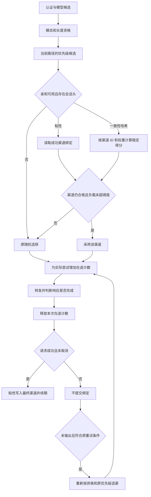

# 渠道亲和与失败处理

亲和作用于 `POST /v1/chat/completions` 和 `POST /v1/completions`。默认关闭，缺少会话头、未匹配规则或未启用 Redis 时沿用原选路。它不替代认证、渠道资格或优先级，也不自动增加协议转发入口。

## 配置

使用既有管理员 `PUT /api/option/`，`key` 为 `AffinityConfig`，`value` 为完整 JSON 字符串。例如：

```json
{"key":"AffinityConfig","value":"{\"enabled\":true,\"inflight_enabled\":true,\"rules\":[{\"enabled\":true,\"model_pattern\":\"*\",\"strategy\":\"session_sticky\",\"options\":{\"header\":\"X-Session-ID\",\"ttl_seconds\":3600}}]}"}
```

内层字段：

| 字段 | 默认和行为 |
| --- | --- |
| enabled | false，总开关 |
| inflight_enabled | false；启用后统计两个接口的实际渠道尝试，无会话的请求也参与负载 |
| rules | 顺序匹配第一条启用规则 |
| model_pattern | 空或 `*` 匹配所有模型，末尾 `*` 匹配前缀，其他值精确匹配 |
| strategy | `session_sticky` 或 `consistent_hash` |
| options.header | `X-Session-ID`；只取请求头，不读取正文、不自动用用户 ID 代替会话 |
| options.ttl_seconds | 3600；0使用默认，仅粘性绑定使用 |
| options.load_aware | true；同时开启 inflight_enabled 才参与负载判断 |
| options.balance_abs_threshold | 32；0使用默认 |
| options.balance_rel_threshold | 1.5；0使用默认 |

Redis 沿用既有 `REDIS_CONN_STRING`、`SYNC_FREQUENCY` 和客户端初始化。没有 Redis 时两种策略都回到普通选路；不维护本机绑定。配置通过原选项同步周期刷新，无需新增表或列。非法配置或保存失败不会替换运行中的规则。需要关闭时保存 `{"enabled":false}`，不要靠删除数据库行触发刷新。

会话键通过已认证用户、分组、原请求模型、请求头值共同计算 SHA-256；不同用户或模型不会共用绑定。模型映射不改变该作用域。请求头值不写日志，也不作为监控标签。

## 选渠与生命周期



- 粘性未命中仍使用原随机选择；只在最终成功时写绑定。单候选也建立/续期，执行期间绑定过期也会重建。重试选渠不再次强制使用旧绑定，成功后迁移到实际成功渠道。
- 一致性哈希使用加权 rendezvous；候选顺序不影响结果，删除候选不使其余请求无故重新分配。未设或零权重按1参与；普通随机降级保留原有权重行为。
- 负载读取当前和上一小时的在途桶，写入桶3小时过期；按权重归一化比较相对中位数，同时满足绝对/相对超载阈值时放弃亲和，回到原随机选择。它不是强制最少连接调度，不能保证随机降级不会再次选中同一渠道。超过约1至2小时的尝试可能不再处于读取窗口，统计属于调度近似值。
- 每个实际尝试获取一次、释放一次；未真正转发的重试候选不计数。释放不受后续取消或配置关闭影响，已消失的计数键不会被释放操作重建。
- 粘性绑定读取失败回到普通选路；运行时负载读取失败跳过负载约束，仍可采用绑定或哈希结果。写入或释放失败记日志，不把已成功响应改成失败。Redis故障或进程崩溃期间在途信息可能不完整，残留受TTL约束。
- 请求固定使用开始时的规则。处理中更改规则时仍按该快照提交；关闭总开关则阻止后续提交。指定渠道首发不建立或读取亲和绑定，仍遵循原分桶豁免约定。

## 流式与错误处理

OpenAI兼容处理器及复用它的智谱 `glm-` 路径，对两个接口采用相同完成判据：收到精确的 `[DONE]`，或所有预期 choice 都有非空 `finish_reason`。Completions批量prompt按prompt数乘n判断，best_of不增加响应数量。辅助id等字段的类型差异不作为损坏JSON。

SSE按空行派发事件，支持`data:`冒号后的可选单个空格、多行data合并、LF/CRLF/CR换行及流首BOM。只有完整事件的数据才进入响应、完成性和usage处理。EOF时仍有未派发data即判未完成，即使此前choice已结束；未闭合的注释、id或event字段不改变结果。完整DONE事件后立即停止读取，其后字节不再影响结果。单行与合并事件数据均受默认扫描大小限制（约64 KiB），超限按读取失败处理。

错误帧、损坏JSON、读错误、未完成EOF或取消均返回失败，不提交亲和、不补成功DONE。首帧前可以按原错误策略重试并返回普通错误JSON；已输出时只能终止SSE，未取消则补SSE错误，不能拼普通JSON或再切换上游。请求取消传给目标HTTP上游，取消本身不增加渠道失败率。其他适配器保留各自原完成判据，不能据此推断所有协议已有相同严格校验。

失败流优先按合法上游usage结算：显式prompt/completion及一致总量，或仅显式总量；合法零值保持零。空对象、仅details、缺单边字段、不一致总数不当作有效usage。有真实内容且无合法usage时沿现有文本估算；只有role、空流或仅错误帧不新增费用。工具/推理内容可证明有消耗，但原估算只累积普通文本，不新增模型专用工具或推理token算法。消费日志中的request_count沿用原计费口径，不代表转发成功数。

失败发生在传输前且预扣过额度时退回预扣。重试切换渠道会先清空上一渠道的SystemPrompt，防止把A的提示词带到没有配置提示词的B。

## 可观测性、兼容与测试

复用原日志/request ID、渠道成功率统计和输入路由日志。亲和debug日志记录strategy、outcome、reason、channel_id；Redis失败有错误日志。未新增Prometheus部署、指标或高基数会话标签。

亲和新键使用 `oneapi:affinity:v1:`，粘性值为渠道ID字符串＋TTL，在途值为小时桶整数。没有修改原额度、缓存键或批处理格式；无数据库migration。旧实例忽略AffinityConfig，可与新实例共用原数据，但不执行亲和、在途或严格断流判断；滚动发布期间行为不同。回退也会恢复旧断流与计费语义，已产生的消费不会自动撤销。

```sh
go test -race ./relay/affinity ./model ./middleware ./controller ./relay/adaptor/openai ./relay/controller
go build ./...
```

纯逻辑和HTTP mock测试默认可运行；真实Redis专项需显式设置 `AFFINITY_TEST_REDIS_URL`，或 `AFFINITY_TEST_REDIS_ADDRS`＋`AFFINITY_TEST_REDIS_PASSWORD`，否则明确skip。测试使用唯一作用域并只删除自身已知键，不清空数据库。Redis Cluster测试连接兼容槽位响应附加元数据；这不是修改应用默认客户端初始化。生产实际Redis拓扑、SDK、模型链和滚动发布仍需在目标环境验证。
